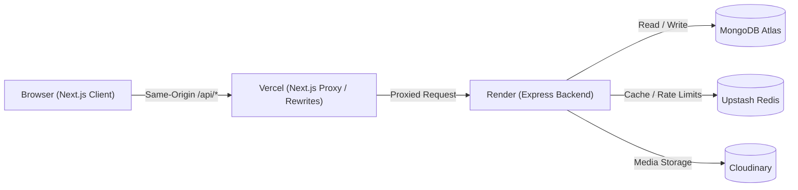

# LinkUp

[](https://github.com/Sahil-baroha/LinkUp/actions/workflows/ci.yml)

LinkUp is a full-stack professional social networking platform built with a high-performance Next.js App Router frontend and a layered Express.js backend. Designed with production resilience and reliability in mind, it provides authentication with HttpOnly cookies, rich profile management with Cloudinary avatars, a personalized connections feed, real-time-like social interactions (posts, comments, likes), two-way connection lifecycles, and search with ranking, backed by MongoDB Atlas persistence and an Upstash Redis cache-aside tier with automated fallback.

---

## Architecture & System Design

### Request Flow



### System Design Highlights

#### Rate-Limiting Tiers
Implemented using custom `ResilientStore` backed by Redis with automatic transparent fallback to memory if Redis is unavailable:

| Tier | Target Endpoints | Limit | Window | Keying Strategy |
|------|------------------|-------|--------|-----------------|
| `rl:authIp` | `POST /auth/register`, `POST /auth/login` | 20 req | 15 min | Client IP (IPv6 subnet safe) |
| `rl:loginAccount` | `POST /auth/login` (failures only) | 10 failures | 15 min | SHA-256(email) |
| `rl:write` | Non-GET mutations on posts & connections | 60 mutations | 1 min | User ID (fallback to IP) |
| `rl:postCreate` | `POST /posts` | 20 creations | 15 min | User ID (fallback to IP) |
| `rl:search` | `GET /users/search` | 30 queries | 1 min | User ID (fallback to IP) |
| `rl:read` | `GET /feed`, `GET /posts/*`, `GET /connections/*` | 120 reads | 1 min | User ID (fallback to IP) |

#### Cache-Aside Keys and TTLs
Managed via `CacheService` in `Backend/utils/cache.js`:

| Key Pattern | Description | TTL | Invalidation Trigger |
|-------------|-------------|-----|----------------------|
| `user:id:<id>` | Sanitized user profile object | 300s (5 min) | Profile update (`PATCH`), avatar change (`PUT`), deactivation (`DELETE`) |
| `user:username:<username>` | Sanitized user profile object | 300s (5 min) | Profile update, deactivation |
| `user:email:<email>` | Sanitized user profile object | 300s (5 min) | Profile update, deactivation |
| `connections:ids:<userId>` | Array of connected user IDs (strings) | 300s (5 min) | Connection accept, reject, withdraw, remove |
| `suggestions:<userId>:<limit>` | Ranked user suggestions list with mutual counts | 120s (2 min) | Natural TTL expiry (2 min) |

#### Failure Modes & Resilience
- **Redis Outage**: When Redis disconnects or fails health checks, rate limiters automatically fall back to process memory via `ResilientStore`, and data repositories seamlessly fall back to direct MongoDB queries without throwing errors or dropping requests.
- **Render Free-Tier Sleep**: Render web services spin down after 15 minutes of inactivity. The Next.js frontend handles 502/503/504 gateway timeouts gracefully with user-facing toasts and warming ping retry cycles to `/api/v1/health`.

#### Health & Observability Endpoints
- `GET /health` and `GET /api/v1/health`: Lightweight unthrottled endpoint returning `{ status: "ok", uptime }` for proxy warmups and uptime monitoring.
- `GET /ready`: Deep readiness probe checking MongoDB ping and Redis status (`{ status: "ready"|"not_ready", mongo: "up"|"down", redis: "up"|"down"|"disabled" }`). Returns HTTP 200 when MongoDB is up (even if Redis is down/degraded) and HTTP 503 if MongoDB is down.
- `GET /api/v1/debug/ip`: Debug endpoint mounted only when `DEBUG_IP_ENDPOINT=true` to inspect client IP, `X-Forwarded-For`, and `trust proxy` configuration.

---

## Tech Stack

- **Frontend**: Next.js 16 (App Router), React 19, TypeScript, Tailwind CSS v4, TanStack Query v5, Zustand, React Hook Form, Zod, Sonner, Lucide React.
- **Backend**: Node.js (ESM), Express.js 5, Mongoose 9, MongoDB Atlas, ioredis 5, Upstash Redis, Multer, Cloudinary SDK, Zod, Helmet.
- **Infrastructure / Deployment**: Vercel (Frontend + Proxy Rewrites), Render (Dockerized Express Backend), GitHub Actions CI.

---

## Features

- **Authentication**: Secure registration and login with bcrypt hashing, stateless JWT stored in HttpOnly, SameSite=Lax cookies, soft-deactivate account.
- **Profile Management**: Profile headline, location, about, skills (deduplicated), experience history, and education history; avatar image uploads directly to Cloudinary with old asset deletion.
- **Connections**: Send connection requests, accept/reject incoming requests, withdraw pending sent requests, remove existing connections; bidirectional connection state tracking (`none`, `pending_sent`, `pending_received`, `connected`).
- **Connection Suggestions**: Two-degree connection graph traversal calculating mutual connections, ranked prefix matching, cached in Redis.
- **Posts & Feed**: Create rich posts with optional Cloudinary images, infinite-scrolling feed of posts from self and accepted connections, post detail view with author metadata.
- **Interactions**: Toggle like/unlike with like counts and user list dialog; nested post comments with create, edit, delete, and pagination.
- **User Search**: Prefix-prioritized user search by name and username with minimum query length and rate limiting.

---

## Local Development Setup

### Prerequisites
- Node.js 22 LTS
- Docker (for local MongoDB and Redis) or active instances of MongoDB and Redis

### 1. Start Services
```bash
# Start MongoDB and Redis containers
docker run -d --name linkup-mongo -p 27017:27017 mongo:7
docker run -d --name linkup-redis -p 6379:6379 redis:7-alpine
```

### 2. Configure Backend
Copy `.env.example` to `.env` in `Backend/`:
```bash
cd Backend
cp .env.example .env
```
Fill in the required configuration:
- `JWT_SECRET`: at least 32 characters
- `MONGO_URL`: `mongodb://localhost:27017/linkup`
- `CLIENT_URL`: `http://localhost:3000`
- `REDIS_URL`: `redis://localhost:6379`
- `CLOUDINARY_*`: (required in production; optional in development for non-upload features)

Install dependencies and start development server:
```bash
npm install
npm run dev # Runs on http://localhost:5000
```

### 3. Configure Frontend
In `frontend/`:
```bash
cd frontend
cp .env.example .env.local
npm install
npm run dev # Runs on http://localhost:3000
```

---

## Environment Variables

### Backend (`Backend/.env`)

| Variable | Required | Default | Description |
|----------|----------|---------|-------------|
| `PORT` | No | `5000` | Port for the Express server |
| `NODE_ENV` | No | `development` | Environment (`development`, `test`, `production`) |
| `MONGO_URL` | Yes | - | MongoDB connection string |
| `CLIENT_URL` | Yes | - | Allowed CORS origin (frontend origin) |
| `JWT_SECRET` | Yes | - | Secret key for JWT signing (>= 32 characters) |
| `TRUST_PROXY` | No | `0` | Reverse proxy hops count (`1` on Render/Vercel) |
| `MONGO_MAX_POOL_SIZE` | No | `10` | Maximum MongoDB connection pool size |
| `REDIS_URL` | No | - | Redis connection URL (`redis://...` or `rediss://...`) |
| `REDIS_HOST` | No | `127.0.0.1` | Redis host (if `REDIS_URL` not set) |
| `REDIS_PORT` | No | `6379` | Redis port (if `REDIS_URL` not set) |
| `REDIS_COMMAND_TIMEOUT_MS` | No | `250` | Command execution timeout in ms |
| `REDIS_CONNECT_TIMEOUT_MS` | No | `2000` | Connection timeout in ms |
| `DEBUG_IP_ENDPOINT` | No | `false` | If true, exposes `GET /api/v1/debug/ip` |
| `DNS_SERVERS` | No | - | Comma-separated custom DNS servers (e.g. `8.8.8.8,8.8.4.4`) |
| `CLOUDINARY_CLOUD_NAME` | In Prod | - | Cloudinary cloud name |
| `CLOUDINARY_API_KEY` | In Prod | - | Cloudinary API key |
| `CLOUDINARY_API_SECRET` | In Prod | - | Cloudinary API secret |

### Frontend (`frontend/.env.local`)

| Variable | Required | Default | Description |
|----------|----------|---------|-------------|
| `BACKEND_ORIGIN` | No | `http://localhost:5000` | Backend origin used for Next.js API route rewrites |
